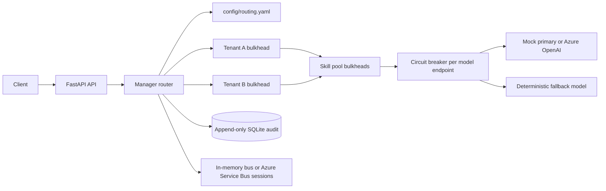
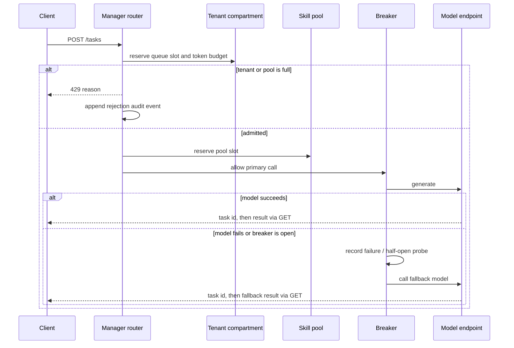
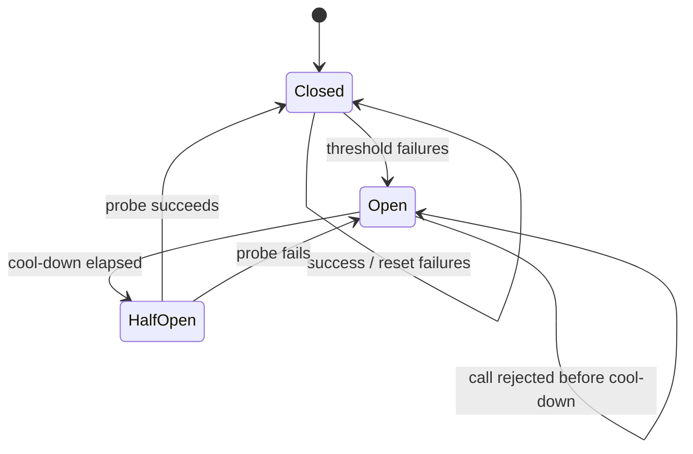

# bulkhead-agent-router

`bulkhead-agent-router` is a small FastAPI service that routes synthetic customer-support tickets to isolated worker pools. It demonstrates two resilience patterns together:

- Bulkheads keep tenant and skill-pool capacity separate. A noisy tenant cannot consume another tenant's queue, semaphore slots, or token budget.
- Circuit breakers stop sending traffic to a failing model endpoint. A fallback model keeps accepted work moving while the primary endpoint is open or failing.

The default provider is deterministic and local. Azure OpenAI is opt-in through environment variables and is never configured with credentials in this repository.

## The problem

A shared worker pool is efficient until one tenant submits a burst of expensive work or a model endpoint begins timing out. The queue grows, latency rises for unrelated tenants, and retries amplify the outage. A model failure can therefore become a cross-tenant failure even when the tenants have no relationship.

This MVP gives every tenant an independent compartment and also limits each functional worker pool (`summarize`, `classify`, and `extract`). Rejections are explicit HTTP 429 responses with a reason; the router never borrows capacity from a different compartment.

## Architecture



Tenant queues, tenant concurrency, and tenant token budgets are checked before admission. Pool queues and pool concurrency are checked at the same boundary. Once admitted, a task uses both a tenant semaphore and a pool semaphore.

## Request flow and rejection



## Circuit breaker

Each configured model endpoint has its own breaker. The default threshold is three failures and the default cool-down is 0.2 seconds.



## Run locally

Requirements: Python 3.12 and `make`. The local provider has no network dependency.

```bash
make seed test
```

Start the API:

```bash
make run
```

Submit a task:

```bash
curl -X POST http://127.0.0.1:8000/tasks \
  -H 'content-type: application/json' \
  -d '{"tenant":"tenant-acme","skill":"summarize","payload":{"text":"The invoice export is missing a charge."}}'
```

The response contains an ID. Fetch it with `GET /tasks/{id}?wait=true`. Other endpoints are:

- `GET /health` reports pool occupancy and breaker states.
- `GET /audit` returns recent audit events.
- `GET /audit?html=true` returns a small HTML table.
- `python -m router audit` prints the local SQLite audit board. `make audit` sets the required local source path.

Configuration lives in `config/routing.yaml`. `scripts/seed.py` uses a fixed RNG seed and writes `data/tickets.jsonl` for the fictional tenants `tenant-acme`, `tenant-globex`, and `tenant-initech`.

## Chaos result

`scripts/chaos_report.py` runs a baseline and then injects 100% primary-model failure for `tenant-acme`. `tenant-globex` continues to succeed because the breaker sends it to the fallback and its tenant compartment remains independent.

The following table is from a local run of `make chaos`; timings are milliseconds and will vary by machine.

| Scenario | Tenant | p95 latency | Failures |
| --- | --- | ---: | ---: |
| baseline | tenant-acme | 2.77 | 0 |
| baseline | tenant-globex | 2.75 | 0 |
| chaos | tenant-acme | 3.70 | 0 |
| chaos | tenant-globex | 1.51 | 0 |

## Azure adapters

`router.bus.AzureServiceBusBus` is an optional session-enabled Service Bus adapter. It uses `DefaultAzureCredential` and sets each message's session ID to the tenant, preserving per-tenant FIFO processing when used with a session-aware queue. `router.bus.CosmosAuditAdapter` is an optional audit sink. The Azure imports are delayed until an adapter is constructed, so local tests do not require the Azure SDKs.

`function_app.py` is an Azure Functions Python v2 entry point with a Service Bus queue trigger. It validates the same `TaskRequest` model and delegates to the same manager core.

The Bicep deployment provisions:

- Standard Service Bus with local authentication disabled, a session-enabled task queue, and dead-lettering.
- Linux Consumption Function App running Python 3.12 and a storage account.
- Serverless Cosmos DB for audit data.
- Application Insights backed by Log Analytics.
- Managed identity RBAC for Service Bus receiver/sender and Cosmos data access.
- A user-assigned deployment identity with a GitHub OIDC federated credential.

Compile the template with:

```bash
make bicep-build
```

The example parameters contain placeholders only. The deployment workflow is `workflow_dispatch` only and uses Azure OIDC; it is not an automatic deployment path.

## Tradeoffs

- Utilization versus isolation: separate queues and semaphores leave capacity idle when one tenant is quiet, but that reserved capacity is the point of the bulkhead.
- Queue sizing: queues that are too small reject normal bursts; queues that are too large hide overload in latency. Size them from measured arrival rates and an explicit latency target.
- Breaker tuning: a low failure threshold protects latency but can open on a transient blip. The cool-down and half-open probe should match endpoint recovery time.
- Service Bus sessions: session ordering gives tenant-level FIFO behavior, but a hot session can become a throughput limit and session locks need operational monitoring.
- Cost: separate pools, telemetry, Service Bus, Cosmos DB, and managed identities cost more than an in-process queue. The design trades that cost for failure containment and auditability.

## What I would do in production

I would persist task state and idempotency keys, use a durable outbox for audit events, and make retry policy explicit rather than retrying every model exception. I would add per-tenant authentication and authorization, quotas backed by a metering store, request cancellation and deadlines, redacted structured logs, and dashboards for queue age, rejection rate, breaker state, fallback rate, and p95/p99 latency. I would load-test queue and session sizing, validate the RBAC deployment in a separate subscription, and add a controlled replay path for dead-lettered messages.

## Project commands

| Command | Purpose |
| --- | --- |
| `make seed` | Generate deterministic tickets |
| `make test` | Run the pytest suite |
| `make run` | Start FastAPI with Uvicorn |
| `make chaos` | Print baseline versus chaos latency |
| `make audit` | Print the local audit board |
| `make bicep-build` | Compile `infra/main.bicep` |
